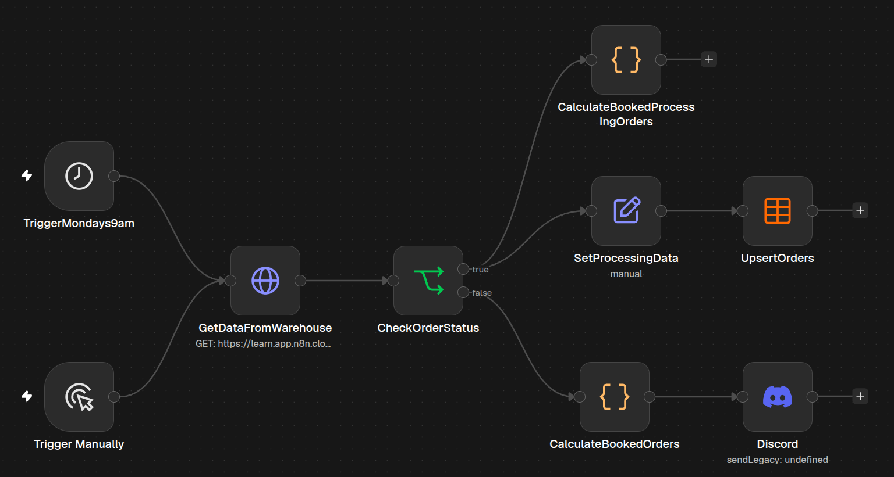

# Getting Started Assessment

 

In this part of the quiz, you will modify Nathan's workflow to test your understanding of the concepts you've learned. You will change some node parameters and functions, then answer questions about the new results. Make sure you attempt the questions in sequence, as each one builds on the previous change.

Before you begin, make sure Nathan's workflow is open in your Editor UI and that all nodes are working correctly.

 

---

  

---

  
