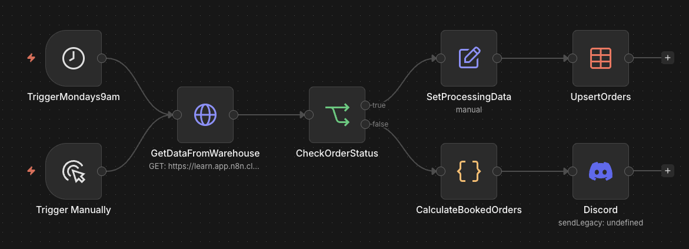

# Designing the workflow

Your client Nathan wants to automate, let's consider the steps he needs to take to achieve his goals:

1. Get the relevant data (*order id, order status, order value, employee name*) from the data warehouse
2. Filter the orders by their status (*Processing or Booked*)
3. Calculate the total value of all the Booked orders
4. Notify the team members about the Booked orders in the company's Discord channel
5. Insert the details about the Processing orders in a Data Table for follow-up
6. Schedule this workflow to run every Monday morning

Nathan's workflow involves sending data from the company's data warehouse to one external service and one built-in n8n feature:

Discord (external)
n8n Data Tables (built-in)
Before that, the data has to be wrangled with general functions (conditional filtering, calculation, scheduling).

n8n provides integrations for all these steps, so Nathan's workflow in n8n would look like this eight-node workflow.

 

---

  

 

---

You will build this workflow in eight steps:

**1. Getting data from the data warehouse**

**2. Inserting data into a Data Table**

**3. Filtering orders**

**4. Setting values for processing orders**
**5. Calculating booked orders**

**6. Notifying the team**

**7. Scheduling the workflow**

**8. Publishing and examining the workflow**

 
